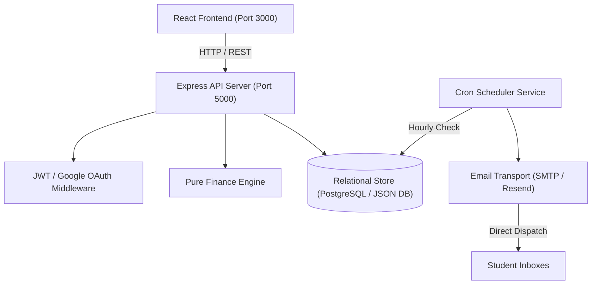
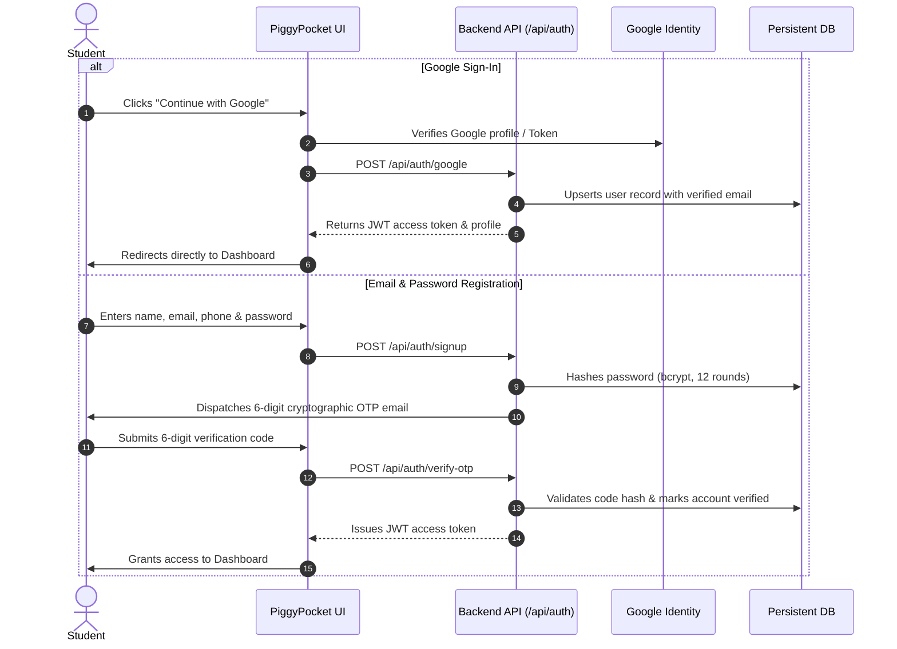

# PiggyPocket

Student Pocket Money and Budget Management System with Adaptive Daily Spending Limits, Google Authentication, and Automated Financial Summaries.

[](https://react.dev/)
[](https://vitejs.dev/)
[](https://nodejs.org/)
[](https://vitest.dev/)
[](LICENSE)
[](https://github.com/TanishkaSahu191)

---

## Table of Contents

- [Overview](#overview)
- [Key Features](#key-features)
- [System Architecture](#system-architecture)
- [Authentication Architecture](#authentication-architecture)
- [Financial Calculation Engine](#financial-calculation-engine)
- [Quick Start Guide](#quick-start-guide)
- [Environment Configuration](#environment-configuration)
- [API Reference](#api-reference)
- [Test Suite](#test-suite)
- [Project Structure](#project-structure)
- [Author and Maintainer](#author-and-maintainer)
- [License](#license)

---

## Overview

PiggyPocket is designed specifically for students and young adults managing monthly pocket money or stipends. Rather than complex corporate accounting, PiggyPocket solves the core problem students face: running out of pocket money before the month ends.

It calculates a dynamic **Safe Daily Spending Limit** that recalculates whenever you log an expense, protects an untouchable **Savings Goal Reserve**, handles mid-month pocket money arrival dates, and delivers scheduled daily financial summaries via email.

---

## Key Features

- **Google Sign-In Authentication**: Instant one-click authentication with Google OAuth profile integration, bypassing verification delays.
- **Persistent Backend Authentication**: BCrypt password hashing, JWT access tokens, HTTP-only refresh cookies, and disk-persisted database storage.
- **Adaptive Daily Spending Limits**: Recalculates safe daily allowance based on remaining days and actual remaining discretionary funds.
- **Accumulated Savings Tracker**: Displays month-over-month cumulative savings reserves alongside individual monthly performance metrics.
- **Interactive Budget Simulator**: Sliders to visualize how reducing discretionary expenses accelerates goal completion.
- **Automated Daily Email Summaries**: Scheduled background email reports via Nodemailer (Gmail App Password) or Resend REST API.
- **Responsive Tactile Interface**: Physical craft design language featuring skeuomorphic leather textures, recessed input slots, and falling coin animations.
- **Dual Storage Resilience**: Local storage caching synchronized seamlessly with the Node.js backend.

---

## System Architecture



---

## Authentication Architecture

PiggyPocket supports multiple secure authentication flows:



---

## Financial Calculation Engine

All financial calculations are implemented in pure, zero-dependency functions (`src/core/financeEngine.js` and `src/services/analyticsService.js`):

### 1. Default Daily Limit Formula

$$\text{Daily Limit} = \left\lfloor \frac{\text{Pocket Money} - \text{Savings Goal}}{\text{Days In Cycle}} \right\rfloor$$

### 2. Adaptive Remaining Daily Limit

$$\text{Safe Daily Allowance} = \max\left(0, \left\lfloor \frac{\text{Current Discretionary Reserve}}{\text{Days Remaining In Cycle}} \right\rfloor\right)$$

### 3. Accumulated Savings Total

$$\text{Total Savings} = \sum_{m \in \text{Months}} \left( \text{Savings Goal}_m + \max(0, \text{Unspent Reserve}_m) \right)$$

---

## Quick Start Guide

<details open>
<summary><b>Step-by-Step Installation Instructions (Click to expand / collapse)</b></summary>
<br>

### Prerequisites
- Node.js version 18.0.0 or higher
- npm version 9.0.0 or higher

### 1. Clone the Repository
```bash
git clone https://github.com/TanishkaSahu191/PiggyPocket.git
cd PiggyPocket
```

### 2. Install Root and Server Dependencies
```bash
npm install
cd server
npm install
cd ..
```

### 3. Launch Development Servers
Open two terminal windows:

**Terminal 1: Start Backend API Server**
```bash
npm run server:start
```
*Backend runs on http://localhost:5000*

**Terminal 2: Start Vite Client Server**
```bash
npm run dev
```
*Frontend runs on http://localhost:3000*

</details>

---

## Environment Configuration

<details>
<summary><b>Server Environment Variables Breakdown (Click to expand)</b></summary>
<br>

Configure your settings in `server/.env`:

```env
# Server Configuration
PORT=5000
NODE_ENV=development
CLIENT_URL=http://localhost:3000

# Optional PostgreSQL Connection (falls back to server/data/piggypocket_db.json)
DATABASE_URL=

# JWT Token Secrets
JWT_ACCESS_SECRET=development_access_secret_piggypocket_2026
JWT_REFRESH_SECRET=development_refresh_secret_piggypocket_2026
JWT_ACCESS_EXPIRY=15m
JWT_REFRESH_EXPIRY=30d

# Option A: Nodemailer SMTP (e.g. Gmail App Password)
SMTP_HOST=smtp.gmail.com
SMTP_PORT=465
SMTP_USER=your_email@gmail.com
SMTP_PASS=xxxx xxxx xxxx xxxx
EMAIL_FROM=PiggyPocket <your_email@gmail.com>

# Option B: Resend REST API
RESEND_API_KEY=re_xxxxxxxxxxxx
EMAIL_FROM=onboarding@resend.dev
```

</details>

---

## API Reference

<details>
<summary><b>Authentication Endpoints (Click to expand)</b></summary>
<br>

| Method | Endpoint | Description | Request Body |
| :--- | :--- | :--- | :--- |
| `POST` | `/api/auth/google` | Google OAuth sign-in & instant account setup | `{ email, fullName, avatar, credential }` |
| `POST` | `/api/auth/signup` | Registers new student account and sends OTP | `{ fullName, email, phone, password }` |
| `POST` | `/api/auth/login` | Email & password login | `{ email, password }` |
| `POST` | `/api/auth/verify-otp` | Validates 6-digit cryptographic verification code | `{ email, code, purpose }` |
| `POST` | `/api/auth/resend-otp` | Resends a fresh 6-digit OTP | `{ email, purpose }` |
| `POST` | `/api/auth/forgot-password` | Initiates password reset OTP | `{ email }` |
| `POST` | `/api/auth/reset-password` | Resets password with valid OTP | `{ email, code, newPassword }` |
| `GET` | `/api/auth/me` | Fetches authenticated user profile | Bearer Token Header |
| `POST` | `/api/auth/logout` | Clears refresh cookies and invalidates session | *None* |

</details>

<details>
<summary><b>Budget and Transaction Endpoints (Click to expand)</b></summary>
<br>

| Method | Endpoint | Description |
| :--- | :--- | :--- |
| `GET` | `/api/budget/:month` | Retrieves budget configuration and metrics for specified month |
| `POST` | `/api/budget/config` | Creates or updates monthly pocket money and savings target |
| `POST` | `/api/budget/expenses` | Logs an expense transaction and recalculates daily allowance |
| `DELETE` | `/api/budget/expenses/:id` | Deletes a logged expense and restores available reserve |
| `POST` | `/api/budget/sync` | Synchronizes offline browser entries to persistent database |
| `GET` | `/api/analytics/summary` | Returns accumulated savings, breakdown by category, and monthly history |

</details>

<details>
<summary><b>Email Scheduler Endpoints (Click to expand)</b></summary>
<br>

| Method | Endpoint | Description |
| :--- | :--- | :--- |
| `GET` | `/api/settings/notifications` | Retrieves email summary preferences and delivery hour |
| `PUT` | `/api/settings/notifications` | Updates scheduled delivery time and notification email |
| `POST` | `/api/settings/test-email` | Dispatches an immediate test email summary to recipient |
| `POST` | `/api/settings/trigger-daily-scheduler` | Manually triggers the automated daily summary batch job |

</details>

---

## Test Suite

PiggyPocket is covered by an automated test suite using **Vitest** and **Supertest**.

To execute all tests:
```bash
npm test -- --run
```

### Current Test Coverage:
- `src/core/financeEngine.test.js`: 15 unit tests verifying all mathematical formulas, leap years, and boundary conditions.
- `src/services/analyticsService.test.js`: 14 tests verifying accumulated savings calculations, month-over-month rollups, and category breakdowns.
- `src/services/storage.test.js`: 11 tests verifying client-side persistence and migration handlers.
- `server/src/server.test.js`: 9 integration tests covering Google authentication, password hashing, budget workflows, and data sync.
- `server/src/services/scheduler.test.js`: 10 tests verifying cron triggers, duplicate prevention, and retry backoff.
- **Total: 59 Tests Passing (100% Green)**

---

## Project Structure

```
PiggyPocket/
├── src/
│   ├── components/
│   │   ├── auth/              # Google Sign-In & auth widgets
│   │   ├── budget/            # Budget setup, summary, & expense cards
│   │   ├── common/            # 3D canvas, buttons, modal dialogs
│   │   ├── dashboard/         # Accumulated savings card & metric grids
│   │   └── layout/            # Navigation bar & layout wrappers
│   ├── core/
│   │   └── financeEngine.js   # Pure math calculation engine
│   ├── pages/
│   │   ├── auth/              # Login, Signup, OTP Verification
│   │   ├── Dashboard.jsx      # Core financial dashboard
│   │   ├── Analytics.jsx      # Spending breakdown & savings chart
│   │   └── Settings.jsx       # Email scheduler & profile preferences
│   ├── services/              # API clients & analytics calculators
│   └── styles/                # Tactile skeuomorphic craft CSS
├── server/
│   ├── src/
│   │   ├── config/            # DB connection & persistent file store
│   │   ├── controllers/       # Auth, budget, and settings handlers
│   │   ├── middleware/        # JWT auth & rate limiters
│   │   ├── routes/            # REST API endpoints
│   │   └── services/          # Email dispatch, OTP, & scheduler
│   └── data/                  # Local persistent JSON database store
├── README.md                  # Interactive project documentation
└── package.json               # Scripts and dependencies
```

---

## Author and Maintainer

Developed and maintained by:

**Tanishka Sahu**  
- GitHub: [@TanishkaSahu191](https://github.com/TanishkaSahu191)  
- Email: [tanishkasahuwork191@gmail.com](mailto:tanishkasahuwork191@gmail.com)  
- Repository: [https://github.com/TanishkaSahu191/PiggyPocket](https://github.com/TanishkaSahu191/PiggyPocket)

---

## License

This project is licensed under the MIT License. You are free to modify, distribute, and build upon this project for educational and commercial purposes.
